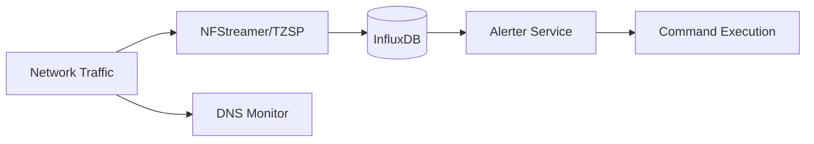

### TZSP Monitor

TZSP Monitor is a comprehensive network monitoring and security solution designed to capture, analyze, and respond to network traffic. By leveraging the TZSP (Traffic Zone Security Protocol) and integrating with a suite of monitoring tools, it provides deep visibility into network activities and allows for automated responses to potential security threats.

#### Key Features
- **Real-time Flow Capture**: Efficiently capture and process network flows using high-performance tools.
- **Detailed Flow Analysis**: Enrich network flows with GeoIP data, application categories, and service mappings.
- **Security Monitoring**: Integrated modules for IDS (Suricata), WIDS, and IP reputation checking.
- **Automated Response**: Execute pre-configured shell commands or webhooks based on detected security alerts.
- **Historical Data Persistence**: Store all network flows and alerts in InfluxDB for long-term analysis and visualization.

#### Supported Modules
- **Collector**: The primary engine for capturing and persisting network flows into InfluxDB.
- **Alerter**: A rule-based engine that monitors InfluxDB for specific conditions and triggers actions.
- **DNS Monitor**: Specifically watches for DNS-related anomalies and blocked queries.
- **IP Reputation**: Cross-references traffic with known C2 feeds.
- **Rule Control**: A centralized interface for managing monitoring rules and thresholds.
- **Mikrotik Responder**: Facilitates interaction and responses with MikroTik networking equipment.
- **Suricata Integration**: Leverages industrial-strength IDS for deep packet inspection.

#### Protocols Supported
- TCP, UDP, ICMP, SCTP
- TZSP (Traffic Zone Security Protocol)
- DNS over TCP/UDP
- HTTP, HTTPS, SSH, FTP, etc.

#### Architecture Overview
TZSP Monitor follows a modular pipeline to ensure telemetry is captured, processed, and acted upon with minimal latency.

The flow is summarized as follows:
1. **Traffic Capture**: Raw network traffic is ingested via `NFStreamer`.
2. **Flow Enrichment**: The `collector` parses TZSP datagrams, extracts session information, and enriches flows with GeoIP and metadata.
3. **Persistence**: Data is written to InfluxDB, providing a high-performance time-series store for all telemetry.
4. **Alerting & Action**: The `alerter` service continuously polls InfluxDB for specific alarm conditions and executes designated responses.

#### Setup & Configuration

### Prerequisites
- **InfluxDB**: A running instance of InfluxDB.
- **NFStreamer**: Installed and configured with access to the capture interface.
- **Suricata**: (Optional) For IDS-based monitoring.

### Environment Variables
Configure the following environment variables to set up the core components:

| Variable | Description | Default |
| :--- | :--- | :--- |
| `INFLUXDB_URL` | URL for the InfluxDB instance | `http://influxdb:8086` |
| `INFLUXDB_TOKEN` | Authentication token for InfluxDB | `my-super-secret-token` |
| `INFLUXDB_ORG` | InfluxDB organization name | `my-org` |
| `INFLUXDB_BUCKET` | Target bucket for network data | `network_traffic` |
| `SNIFF_INTERFACE` | The network interface to monitor | `wlp0s20f3` |

### Running the Components
- **Collector**: Run via `python3 collector/main.py`.
- **Alerter**: Run via `python3 alerter/alerter.py`.
- **DNS Monitor**: Run via `python3 dns-monitor/monitor.py`.

